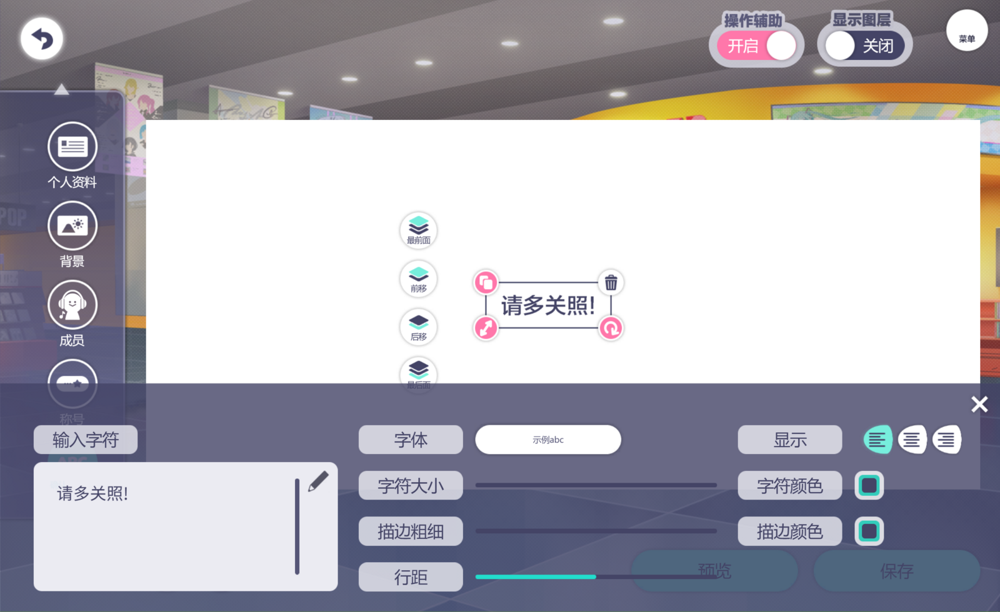

# Sekai Custom Profile SDK

English | [简体中文](README.zh-CN.md)

Sekai Custom Profile SDK is an unofficial development kit for Project SEKAI
(PJSK) custom profile cards. It edits game-compatible card documents and
renders them, natively on the CPU or in the browser with WebGL2.

Rich text and layout follow a compatibility model of the Unity TextMesh Pro
data, tags and runtime behavior that PJSK uses. The model covers the tags,
layout, materials and dynamics this repository implements and tests. Game
behavior it does not model, and later game updates, can differ from the
client, so the SDK does not guarantee the game's rendering logic or final
pixels.

## Live demo

[profile.emptysekai.dev](https://profile.emptysekai.dev) is built on the
browser renderer and edits and previews custom profile cards in the browser.



## Features

- Game-structure-compatible authoring documents with transactions,
  gestures, undo/redo, checkpoints and export.
- One backend-independent Rust core for profile and masterdata resolution,
  dynamics, stable IDs, masks, controls and interaction geometry, shared by
  both renderers.
- TextMesh Pro-compatible rich-text parsing and layout, with FreeType
  metrics and SDF glyphs.
- A native CPU renderer for servers, command-line tools and offline jobs:
  PNG and JPEG pages, whole-profile batches and animation export (GIF, WebP,
  APNG, MP4).
- A WebGL2 browser renderer driven by Rust/WASM in a worker, with dynamic
  scenes, layer visibility, tabs, scrolling and hit geometry.
- Host-defined font, localization and image providers: the application
  decides where every resource comes from.
- Inspectable scene dumps and bounded telemetry.

## Packages

| Package | Contents |
| --- | --- |
| npm [`@empty-sekai/sekai-custom-profile-sdk`](crates/sekai-profile-wasm/README.md) | Browser renderer and authoring client: TypeScript wrapper and WASM runtime |
| crate `sekai-profile-core` | Backend-independent scene schema, profile resolution, authoring documents, dynamics and interaction geometry |
| crate `sekai-profile` | Native CPU renderer, JSON masterdata provider, asset store and atlas building |
| crate `sekai-profile-cli` | The `sekai-profile` command: `render`, `prepare` and `serve` |
| crate `sekai-profile-wasm` | Source of the npm package (not published as a crate) |

Each [GitHub Release](https://github.com/empty-sekai/sekai-custom-profile-sdk/releases)
provides the `sekai-profile` executable for Linux x86_64 and aarch64,
Windows x86_64 and macOS aarch64, the browser build (`dist/`) as a zip, and
`SHA256SUMS`.

## Quick start

### Browser

```sh
npm install @empty-sekai/sekai-custom-profile-sdk
```

```ts
import {
  BrowserRenderer,
  type FontProvider,
  type ResourceProvider,
} from "@empty-sekai/sekai-custom-profile-sdk";

const fontProvider: FontProvider = {
  async provide({ region, family }, { signal }) {
    const bytes = await loadApplicationFont({ region, family, signal });
    return bytes ? { bytes } : null;
  },
};

const resourceProvider: ResourceProvider = {
  cacheIdentity(descriptor) {
    return `catalog-2026-07:${descriptor.id}`;
  },
  async provide(descriptor, { signal }) {
    const request = await resolveApplicationResource(descriptor);
    if (!request) return null;
    const response = await fetch(request, { signal, cache: "default" });
    if (!response.ok) return null;
    return { source: await response.blob() };
  },
};

const renderer = await BrowserRenderer.create({
  canvas: document.querySelector("canvas")!,
  region: "en",
  resourceProvider,
  fontProvider,
});

const masterData = await renderer.loadMasterData(
  "latest",
  ({ table, region, revision }, { signal }) =>
    loadApplicationMasterData({ table, region, revision, signal }),
);
const scene = await renderer.createProfileScene({
  masterData,
  documentKey: "profile-preview",
  // The full Profile API response. The page is taken from
  // userCustomProfileCards in ascending seq order: the first one, or pageIndex.
  profile,
  frameMode: "animate",
});

scene.draw();
```

`loadApplicationFont`, `resolveApplicationResource` and
`loadApplicationMasterData` stand for the application's own loaders. The
[browser package README](crates/sekai-profile-wasm/README.md) covers the
provider contracts, authoring, interaction and caching.

### Rust

```toml
[dependencies]
sekai-profile = { git = "https://github.com/empty-sekai/sekai-custom-profile-sdk", tag = "v<version>" }
serde_json = "1"
```

```rust
use std::path::Path;
use std::sync::Arc;

use sekai_profile::profile::ProfileData;
use sekai_profile::region::Region;
use sekai_profile::types::UserCustomProfileCard;
use sekai_profile::{AssetStore, CustomProfileRenderer, JsonMasterDataProvider, RenderConfig};

fn main() -> Result<(), Box<dyn std::error::Error>> {
    sekai_profile::set_font_dirs(["fonts"]);
    let masterdata =
        JsonMasterDataProvider::from_dir(Path::new("masterdata"))?.with_region(Region::Jp);
    let assets = AssetStore::new(256);
    assets.load_png_dir(Path::new("assets"))?;
    let renderer = CustomProfileRenderer::new(Arc::new(masterdata))
        .with_assets(Arc::new(assets))
        .with_atlas_dir("atlases")?;

    let response: serde_json::Value = serde_json::from_slice(&std::fs::read("profile.json")?)?;
    let pages: Vec<UserCustomProfileCard> =
        serde_json::from_value(response["userCustomProfileCards"].clone())?;
    let first = sekai_profile::core::profile_source::profile_page(&pages, 0).expect("a page");
    let profile = ProfileData::from_json(&response);

    let page = renderer.render(&first.custom_profile_card, Some(&profile), &RenderConfig::default())?;
    std::fs::write("card.png", page.to_png()?)?;
    Ok(())
}
```

The atlases come from `sekai-profile prepare` or
`sekai_profile::prepare::prepare_atlas_dir`. See
[native renderer](docs/native-renderer.md) for encoding, configuration,
batches, animations and cache keys.

### Command line

```sh
sekai-profile prepare --masterdata ./masterdata --font-dir ./fonts \
  --assets-dir ./assets --atlas-dir ./atlases

sekai-profile render --profile ./profile.json --masterdata ./masterdata \
  --assets-dir ./assets --font-dir ./fonts --atlas-dir ./atlases -o card.png
```

`render` also prepares the glyphs a page needs, so `prepare` is optional
for single renders. `serve` answers render requests as NDJSON on stdin. See
[command line](docs/cli.md).

## Documentation

- [Architecture](docs/architecture.md): responsibilities, scene creation,
  layers and interaction, caches, debugging and telemetry.
- [Native renderer](docs/native-renderer.md): the Rust library API, the plain
  CPU canvas, Cargo features and environment variables.
- [Command line](docs/cli.md): `render`, `prepare`, `serve`, masterdata and
  asset sources.
- [Fonts, atlases and assets](docs/fonts-and-assets.md): the atlas
  directory, font files, masterdata tables, collections and asset keys.
- [Development](docs/development.md): building, testing, CI, commits and
  releases.
- [Browser package](crates/sekai-profile-wasm/README.md): the npm package
  API.
- [Demo](crates/sekai-profile-wasm/demo/README.md): the browser reference
  application.

## Building from source

The Rust crates need FreeType (through pkg-config, or the `bundled-freetype`
feature); the WASM runtime builds in a container with
`crates/sekai-profile-wasm/build.sh`. See [development](docs/development.md).

## License

The repository is licensed under AGPL-3.0-only ([LICENSE](LICENSE)). The npm
package also carries a limited additional permission for linking the
unmodified package into front-end code that runs in a web browser
([LICENSE-EXCEPTION](crates/sekai-profile-wasm/LICENSE-EXCEPTION)). Modified
builds, server use and any other non-browser use remain under the full AGPL,
including its network-use source requirement.
